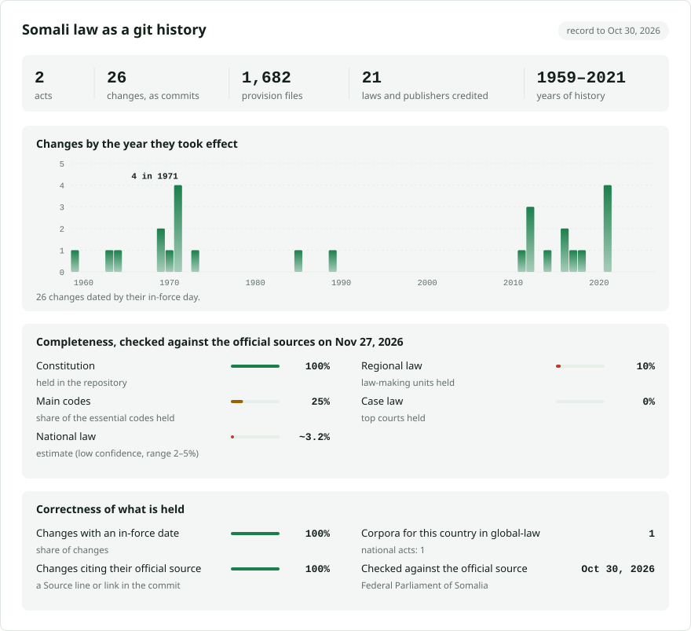

# Somalia: law history in git

<picture>
<source media="(prefers-color-scheme: dark)" srcset="data/effort-dark.svg">

</picture>

The law of Somalia as a git history: one file per provision (an article, or a schedule of the Constitution), one commit per version on the day it took effect, and the law that made each change as the commit's author. Each act has one version so far; a later version is added as a new commit, so that `git log` and `git blame` show each change from this version on.

Part of [lexifina/global-law](https://github.com/lexifina/global-law), one git history for every country's law: this is Somalia's national law, which global-law reads at `somalia/national/acts/`.

**What is in it now:** two acts, each in one version: the Provisional Constitution of the Federal Republic of Somalia, adopted on 1 August 2012 (143 articles and 2 schedules), and the Penal Code of 1962 (Decreto legislativo 16 dicembre 1962, n. 5; articles 1 to 565, in 557 files): 702 provision files in all. [`data/versions.json`](data/versions.json) lists both acts with their sources, and each act's folder has a `README.md` listing its provisions.

Each act is in its own folder, one file per article: `provisional-constitution/art-024.md` is Article 24 (Labour Relations) of the Constitution, and `codice-penale/art-001.md` is Article 1 of the Penal Code.

The Constitution is in English, the version the Federal Parliament publishes (it also publishes a Somali text, which is not used). The Penal Code is in Italian, the language it was enacted in, as OCR read it from a scan; neither its Somali text nor an English translation is part of this record.

## Questions as git commands

| Question | Command |
| --- | --- |
| Every change to Article 24 (Labour Relations) of the Constitution | `git log -p --word-diff -- provisional-constitution/art-024.md` |
| Which version wrote each line of Article 24? | `git blame provisional-constitution/art-024.md` |
| Every version of Article 24, with the day each took effect | `git log --format="%h %(trailers:key=In-force,valueonly,separator=) %an" -- provisional-constitution/art-024.md` |
| Article 24 as in force on 1 January 2026 | `python tools/on.py 2026-01-01 provisional-constitution art-024` |

**Outside git**, we also host this record publicly, for free:

- **[Ask Claude about Somali law](https://global-law.lexifina.com/v1/try_claude?country=somalia)**: opens Claude with a first question ready.
- **[Ask ChatGPT](https://global-law.lexifina.com/v1/try_chatgpt?country=somalia)**: the same question in ChatGPT.
- **[Search Somali law on our site](https://lexifina.com/law?country=somalia&q=trade+union)**: a search for "trade union", with each provision's text and its versions, no account needed.
- **[Developer REST API](https://global-law.lexifina.com/v1/search_law?query=trade+union&jurisdiction=somalia)**: the same search as JSON, with no key. See the [documentation here](https://lexifina.com/api/global-law).

Both assistants read the record through the free Global law connector (MCP, `https://global-law.lexifina.com/mcp`); the first time, the chat gives you the link that adds it. Ask in English or in Italian.

**Host it yourself easily.** All it takes is git and Python, and the tools run on your machine:

```sh
git clone --depth 1 https://github.com/lexifina/global-law && cd global-law
python3 tools/countries.py add somalia/national/acts
python3 tools/law.py show 2026-01-01 somalia/national/acts/provisional-constitution/art-024.md
```

Opened in Claude Code, Cursor, VS Code or Codex, the clone also starts a local MCP server with the same tools ([MCP.md](https://github.com/lexifina/global-law/blob/main/MCP.md)).

## Dates

Each law commit carries the day its version took effect in its `In-force:` trailer:

- the Provisional Constitution, 1 August 2012, the adoption date on its cover, dated at noon, Africa/Mogadishu;
- the Penal Code, 3 April 1964, the day commonly given for its entry into force: the decree takes effect six months after its publication in the Bollettino Ufficiale of 2 October 1963 (Supplement 1 to no. 10);
- git cannot store dates before 1970, so the Penal Code's commit is dated 1 January 1970, with the real day in `In-force:`. Ask for a date with `tools/on.py`, not `git log --before`.

The Constitution is credited to its publisher, the Federal Parliament of Somalia, as the oldest version available (`Kind: publisher`); the Penal Code is credited to the decree that enacted it, `D.Lgs. 5/1962` (`Kind: law`).

## How it is checked

- `tools/check_repo.py` reads every version back from git on the day it took effect and on the day before, and compares it with the corpus the repository was built from: 0 mismatches over 2 versions (see [`REPRODUCE.md`](REPRODUCE.md)).
- Every commit's trailers parse; there are no merge commits, commit dates never go back and none is in the future. The corpus's sha256 is in [`data/corpus.sha256`](data/corpus.sha256); no second build has been compared yet.
- The Penal Code's OCR text was compared with the scan on random pages: they matched except for misreadings like those below.
- History is append-only: newer versions and new acts go on top (`tools/append.py`), and no published commit is rewritten.

## What it does not show

- **The rest of the statute book**, including the civil and commercial codes, and any regulations, case law or laws of the federal member states.
- **Amendments to the Constitution**, including those of 2024 to Chapters 1 to 4: the Federal Parliament publishes the text as adopted and no consolidated version. The flag and emblem schedules are pictures and are not included.
- **A clean Penal Code text.** The files are OCR text with misreadings (such as "pubplici", "precedenie", and a damaged passage in article 2): check the scan before relying on any wording. Articles 186, 226, 309, 348, 420, 438, 451 and 539 have no file of their own; their text sits at the end of the article before. Headings (Libro, Titolo, Capo) and the index are left out.
- **The Penal Code since 1962.** It has been amended, and its status differs across Somalia, Somaliland and Puntland; this is the text as enacted.

## Sources

| Source | Kind | Past versions | Notes |
| --- | --- | --- | --- |
| [Federal Parliament of Somalia](https://parliament.gov.so) | Official publisher: the Provisional Constitution (English version) | no, the text as adopted | One born-digital [PDF](https://parliament.gov.so/wp-content/uploads/2024/12/Provisional-Constitution-2012.pdf), retrieved on 29 October 2026 |
| [Università Roma Tre, Archivio Leggi della Somalia (1950-1989)](https://arcadia.sba.uniroma3.it/handle/2307/17142) | Archive copy: the Penal Code (Italian), a scan of a printed edition | no, the code as enacted | A third-party copy, not a Somali government site; read with Tesseract 5.4; retrieved on 30 October 2026 |

## Licence

See [`LICENSE`](LICENSE). The Federal Parliament states no licence for the Constitution, which is reproduced with attribution; laws are not protected by copyright under Article 5 of the Somali Copyright Law (Law No. 66 of 7 September 1977), though whether that law is still applied is not settled. Lexifina's arrangement, commit messages and tools are CC BY 4.0.

No model wrote, translated or corrected legal text, and no model runs at build time; the scripts were written by Claude Code under Lexifina's direction, and the Penal Code was read by OCR (see [`REPRODUCE.md`](REPRODUCE.md)).

## More

From [lexifina/global-law](https://github.com/lexifina/global-law):

- [FEATURES.md](https://github.com/lexifina/global-law/blob/main/FEATURES.md): every feature, and what every corpus must support (`git blame`, `law.py`, the MCP tools)
- [FAQ.md](https://github.com/lexifina/global-law/blob/main/FAQ.md): questions and answers · [CONTRIBUTING.md](https://github.com/lexifina/global-law/blob/main/CONTRIBUTING.md): proposing changes · [MCP.md](https://github.com/lexifina/global-law/blob/main/MCP.md): the MCP server · [REPRODUCE.md](https://github.com/lexifina/global-law/blob/main/REPRODUCE.md): how it was built · [CHANGELOG.md](https://github.com/lexifina/global-law/blob/main/CHANGELOG.md)
- [FRESHNESS.md](https://github.com/lexifina/global-law/blob/main/FRESHNESS.md): how current each corpus is · [Monitoring](https://github.com/lexifina/global-law/tree/main/monitoring): whether updates are running · [WATCHING.md](https://github.com/lexifina/global-law/blob/main/WATCHING.md): how each official source is watched for changes
- [performance/](https://github.com/lexifina/global-law/tree/main/performance): how fast the tools are, measured
- [visualisations/](https://github.com/lexifina/global-law/tree/main/visualisations): charts and bridges across the world's law
- [Vulnerabilities](https://github.com/lexifina/global-law/tree/main/vulnerabilities): mistakes in legislation as published
